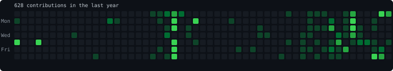

<h1 align="center">Shaurya Garg</h1>
<p align="center"><i>building agents that talk, think, and occasionally finish the task</i></p>

<p align="center">
  
</p>

---

### `> whoami`

```yaml
focus:
  - LLM research: reasoning, tool use, evals, and where agents break
  - agentic workflows: planners, executors, verifiers, test-gated loops
  - voice agents: streaming STT → LLM → TTS, barge-in, sub-second turn-taking
  - infra for agents: worktrees, sandboxes, cost-aware model routing
daily_driver: Arch Linux (btw) — tiling WM, dotfiles, terminal-first, tinkered to the kernel
currently: making multi-agent pipelines cheaper without making them dumber
belief: "an agent without an eval is just a demo"
```

### `> ls ~/research-interests`

- **Agent orchestration** — decomposing work across agents, verifying each step, failing loudly
- **Model routing** — send each step to the cheapest model that clears its test gate
- **Voice-native agents** — latency budgets, interruption handling, turn detection, tool calls mid-conversation
- **Evals & reliability** — trajectory-level evals, regression suites for prompts, LLM-as-judge done carefully
- **Linux, all the way down** — Arch daily driver, self-hosted homelab on Tailscale + Cloudflare Tunnels, if it can run from a terminal it will
- **Memory & context** — long-horizon tasks, context compression, retrieval that actually helps

### `> ls ~/projects --featured`

| project | what it does |
|---|---|
| [**free-code**](https://github.com/Shauryaroks/free-code) | Runs coding-agent CLIs in parallel across git worktrees, routing each step to the cheapest agent that passes its test gate |
| [**occultism**](https://occultism.shauryaroks.me) | Agent Builder — compose, run, and inspect agentic workflows |
| [**WarRoom**](https://github.com/Shauryaroks/WarRoom) | Real-time case competition platform for 32–40 teams: LLM-evaluated strategy submissions with human-in-the-loop validation, plus a live market trading stock in each other's companies |
| [**perplexed**](https://github.com/Shauryaroks/perplexed) | Research/answer engine experiments |
| [**inference-engine**](https://github.com/FloatingComet62/inference-engine) | CPU-based inference engine optimized for TinyLlama-1.1B *(with @FloatingComet62)* |

### `> git log --author=me --elsewhere`

| repo | contribution |
|---|---|
| [openfolie/simulation](https://github.com/openfolie/simulation) | Open-world RL environment |
| **occult-voice-agent** *(private)* | Voice agent behind the occultism stack |
| **TechnitosAI/CompanyBrain** *(private)* | Company knowledge brain; fixed folder/file format inconsistencies |
| [devyangggg/city-optimization-program](https://github.com/devyangggg/city-optimization-program) | Built the first agent pipeline for macrogrid infrastructure optimization |
| [devyangggg/poseidon](https://github.com/devyangggg/poseidon) | Initial backend |
| [EV cost prediction](https://github.com/reshamsai150/7.Analysis-and-Prediction-of-Electric-Vehicle-Costs-A-Machine-Learning-Based-Approach) | RandomizedSearchCV hyperparameter tuning for XGBoost |

### `> curl live-deployments`

*self-hosted on my own box, served through Cloudflare Tunnels*

- 🌐 [**shauryaroks.me**](https://www.shauryaroks.me) — home base / portfolio

### `> cat stack.txt`

**languages**  


**ai / ml**  


**backend**  


**frontend**  


**infra / ops**  


### `> stats`




---

<p align="center"><sub>open to research collabs on agents, evals, and voice</sub><br/><a href="mailto:shauryagarg76@gmail.com"></a>
<a href="https://www.linkedin.com/in/shaurya-garg-801615313"></a>
<a href="https://x.com/shauryagarg76"></a></p>
